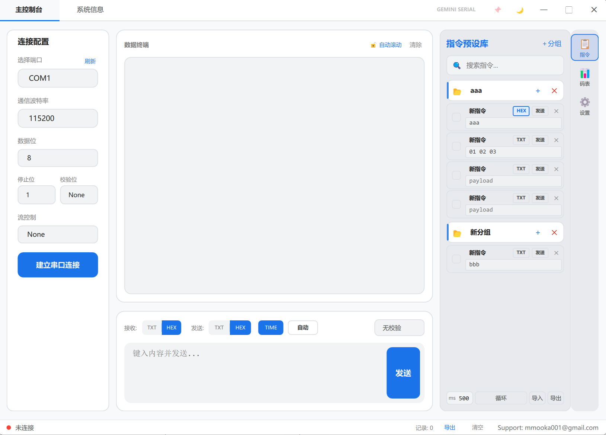
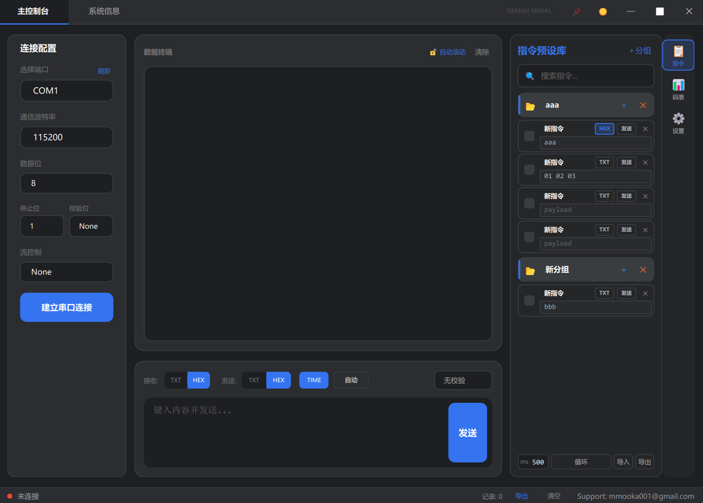

# Gemini Serial


Gemini Serial 是一款使用 **Qt 6、QML 和 C++17** 开发的现代化串口调试助手。它面向嵌入式开发、硬件联调、协议测试和串口设备维护，提供清晰的收发终端、HEX/TXT 模式、校验计算、指令预设、循环发送、记录导出及明暗主题。

> 当前版本以 Windows 为主要运行平台，源码可使用 Qt Creator 或 CMake 构建。

## 界面预览

### 浅色主题



### 深色主题



## 功能亮点

- 完整串口参数配置：端口、波特率、数据位、停止位、校验位和流控制
- TXT、HEX 收发模式及双格式数据显示
- BCC、SUM8、CRC16 Modbus 等校验方式
- 指令分组、搜索、编辑、导入与导出
- 多指令循环发送和可配置发送间隔
- 自动发送、时间显示和收发字节统计
- 通信记录清空与 CSV 导出
- 明暗主题切换、窗口置顶和 Windows 原生窗口吸附
- 响应式界面，在不同窗口宽度下自动收纳发送工具栏
- 指令与界面设置持久化保存
- 统一模块布局、液态玻璃导航选框及长按滑动切换
- 深色、浅色、跟随系统，以及配色风格、色谱和 HEX 自定义强调色
- 可拖选复制的终端消息、指令长按排序和右键操作菜单

## 技术栈

- Qt 6: Core、Gui、Quick、Qml、SerialPort、QuickDialogs2、ShaderTools
- QML / Qt Quick Controls 2
- C++17
- CMake 3.16+

## 快速开始

### 下载发布版

不需要本地安装 Qt。前往 [GitHub Releases](https://github.com/mmooka001/Serial_Gemini/releases) 下载 Windows x64 ZIP，解压后运行 `GeminiSerial.exe`。

### 环境要求

1. 安装 Qt 6，并选择对应编译器套件，例如 MinGW 64-bit。
2. 确保已安装 CMake 3.16 或更高版本。
3. 推荐使用 Qt Creator 直接打开项目根目录的 `CMakeLists.txt`。

### Qt Creator

1. 克隆仓库：

   ```bash
   git clone https://github.com/mmooka001/Serial_Gemini.git
   cd Serial_Gemini
   ```

2. 使用 Qt Creator 打开 `CMakeLists.txt`。
3. 选择包含 Qt SerialPort、QuickDialogs2 与 ShaderTools 的 Qt 6 Kit（ShaderTools 用于编译液态玻璃着色器）。
4. 配置、构建并运行 `MySerial_Gemini`。

### CMake 命令行

```bash
cmake -S . -B build -DCMAKE_PREFIX_PATH=/path/to/Qt/6.x/compiler
cmake --build build --parallel
```

Windows 下生成的程序通常位于：

```text
build/MySerial_Gemini.exe
```

## 使用说明

1. 在左侧选择串口并配置通信参数。
2. 点击“建立串口连接”。
3. 在底部选择 TXT 或 HEX 发送模式，输入数据后发送。
4. 在左侧切换到指令预设库，保存常用命令并按列表顺序循环发送已勾选指令；发送框拥有独立的循环开关和间隔。
5. 在底部状态栏查看 RX/TX 字节统计，按需导出通信记录。

HEX 输入支持空格分隔格式，例如：

```text
01 03 00 00 00 02
```

## 项目结构

```text
.
├── Main.qml             # 主界面与交互逻辑
├── main.cpp             # 应用入口及 QML 后端注册
├── SerialManager.*      # 串口连接、收发与窗口辅助功能
├── CommandStore.h       # 指令分组及持久化
├── ChecksumHelper.h     # 校验计算
├── RecordStore.h        # 通信记录与统计
├── SettingsStore.h      # 应用设置持久化
├── tests/               # 回归检查
└── CMakeLists.txt       # Qt/CMake 构建配置
```

## 数据存储

指令和设置保存在 Qt 标准应用数据目录中：

- `commands.json`：指令分组与内容
- `QSettings`：界面与通信相关设置

## 测试

运行发送工具栏响应式布局回归检查：

```powershell
powershell -ExecutionPolicy Bypass -File .\tests\send_toolbar_layout_test.ps1
```

## Windows 发布包

使用已安装的 Qt 6 MinGW 工具链生成独立运行的便携 ZIP：

```powershell
./scripts/package-windows.ps1 -QtRoot D:/Qt/6.11.0/mingw_64 -CompilerBin D:/Qt/Tools/mingw1310_64/bin -NinjaExecutable E:/DevTools/ninja-win/ninja.exe
```

脚本构建 Release、部署 Qt 与编译器运行库，输出 ZIP 和 SHA-256 校验文件到 `release_artifacts/`。包内不包含源码、测试、日志或个人指令数据。打包说明见 [v0.2.0 更新记录](docs/RELEASE_NOTES_v0.2.0.md)。

## 参与贡献

欢迎提交 Issue 或 Pull Request。提交前请确保：

- 项目能够完成全新 CMake 配置与构建
- 不提交 `build/`、部署 DLL、IDE 用户配置和本地日志
- 用户可见行为变更附带必要说明或测试

## 许可证

本项目基于 [MIT License](LICENSE) 开源。

## 联系方式

- GitHub: [@mmooka001](https://github.com/mmooka001)
- Email: mmooka001@gmail.com

